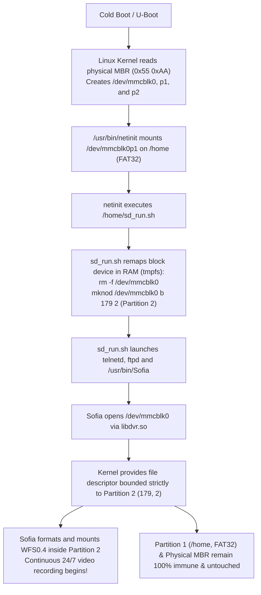

# 📹 XM-DualStorage: Persistent Root & Native WFS0.4 Video Recording Coexistence on Xiongmai XM530 / Sofia IP Cameras

[](https://opensource.org/licenses/MIT)
[]()
[]()
[]()

> **The first documented, open-source solution enabling persistent root shell access, Telnet, FTP file management, and native 24/7 surveillance video recording on the exact same MicroSD card without bricking or data loss.**

---

## 📌 The Problem: The Xiongmai WFS Barrier

Xiongmai (XM) IP cameras and DVRs based on **XM530, XM510, XM550, and HiSilicon SoCs** (running the proprietary surveillance daemon `/usr/bin/Sofia`) contain an OEM boot hook: on boot, `/usr/bin/netinit` automatically mounts a FAT32 MicroSD card and executes `/home/sd_run.sh` with `root` privileges.

While security researchers and hobbyists have historically used this hook to open a Telnet shell, **retaining normal camera video recording has remained an unsolved problem**:

1. **The Format Collision (Error 1002)**:
   - Xiongmai's proprietary filesystem driver, **WFS0.4 (Xiongmai File System)**, checks Sector 0 of the storage device.
   - It requires the ASCII magic string `"WFS0.4\0"` at offset 0 and the proprietary Xiongmai signature `'X'` `'M'` (`0x58 0x4D`) at offsets 510–511.
   - When a standard partition table (MBR) is present on the card, offsets 510–511 contain standard IBM PC MBR magic: `0x55 0xAA`.
   - `Sofia` rejects the card with internal error **`1002` (`0x3EA`: `"wfs_read_partitions ver no match"`)** and refuses to record.

2. **Destructive Auto-Format (`FUN_001fe3ac`)**:
   - In subsequent reboot attempts, `Sofia`'s storage initialization routine falls back to a destructive low-level format (`FUN_001fe3ac`).
   - It overwrites Sector 0, destroys the MBR, and converts the entire 64 GB card into a raw, monolithic WFS partition.
   - **Result**: All user scripts (`sd_run.sh`), custom binaries, and root access are permanently wiped.

---

## 🚀 The Solution: Kernel Block Device Virtual Redirection

Rather than modifying the vendor binary `/usr/bin/Sofia` or attempting to build a hybrid filesystem driver, this project resolves the conflict at the **Linux kernel block layer**:



### Why It Works:
- `/dev` is mounted on **`tmpfs`** (RAM-backed, writable filesystem).
- `netinit` mounts **Partition 1** (`179, 1`) to `/home` and runs `sd_run.sh` **before** `Sofia` initializes.
- `sd_run.sh` re-creates `/dev/mmcblk0` pointing to **Partition 2** (`Major 179, Minor 2`).
- When `Sofia` opens `/dev/mmcblk0`, the kernel bounds all I/O strictly within Partition 2. `Sofia` writes its `WFS0.4` and `XM` signatures inside Partition 2, while the physical MBR (Sector 0) and Partition 1 (`/home`) remain completely isolated by hardware-enforced block boundaries.

---

## 🛠️ Quick Start (Automated Setup)

The easiest and safest way to prepare your MicroSD card is using the included cross-platform Python tool [`xm_format_sd.py`](xm_format_sd.py).

### Windows & Linux:
1. Connect your MicroSD card via a USB card reader.
2. Run the script as Administrator / root:
   ```bash
   # Windows (Run PowerShell / CMD as Administrator):
   python xm_format_sd.py

   # Linux:
   sudo python3 xm_format_sd.py
   ```
3. Enter your MicroSD drive letter (e.g., `H` or `E`) or disk number.
4. The tool will:
   - Partition the card into **Partition 1 (FAT32)** and **Partition 2 (Raw for Sofia)**.
   - Install [`sd_run.sh`](sd_run.sh) and the `FormatOk` protection flag.
   - Copy `busybox` (if present in the script directory).
5. Safely eject the card, insert it into your powered-off camera, and turn it on!

---

## 🔧 Manual Setup (Linux / fdisk)

If you prefer to partition manually:

### 1. Partition the MicroSD Card
```bash
# Assuming /dev/sdb is your MicroSD card:
sudo parted -s /dev/sdb mklabel msdos
sudo parted -s /dev/sdb mkpart primary fat32 1MiB 2049MiB
sudo parted -s /dev/sdb mkpart primary 2049MiB 100%
sudo mkfs.vfat -F 32 -n "XM_BOOT" /dev/sdb1
```

### 2. Copy `sd_run.sh` to Partition 1
Place this exact script at the root of Partition 1 as **`sd_run.sh`**:

```sh
#!/bin/sh
# ==============================================================================
# sd_run.sh - Universal Dual Storage & Root Coexistence Hook (Xiongmai / Sofia)
# ==============================================================================

# 1. KERNEL BLOCK SHIELD: Protect FAT32 & Bind Sofia directly to Partition 2
mv -f /dev/mmcblk0 /dev/mmcblk0_raw 2>/dev/null || true
rm -f /dev/mmcblk0
mknod /dev/mmcblk0 b 179 2

# 2. BASE ENVIRONMENT & REQUIRED DIRECTORIES IN PARTITION 1 (/home)
mkdir -p /home/cam_00 /home/log /home/conf /home/backups
touch /home/FormatOk

# 3. OPTIONAL BUSYBOX EXPANSION (If busybox binary is present)
if [ -x "/home/busybox" ]; then
    mkdir -p /tmp/bin
    /home/busybox --install -s /tmp/bin 2>/dev/null || true
    export PATH="/tmp/bin:/home:/bin:/sbin:/usr/bin:/usr/sbin:$PATH"
fi

# 4. REMOTE ACCESS SERVICES: Telnet (Port 23) & FTP Server (Port 21)
if [ -x "/home/busybox" ]; then
    /home/busybox telnetd -l /bin/sh -p 23 &
    /home/busybox tcpsvd -vE 0.0.0.0 21 /home/busybox ftpd -w /home >/dev/null 2>&1 &
else
    telnetd -p 23 &
fi

# 5. LAUNCH SOFIA: Native surveillance daemon over isolated Partition 2
if [ -x "/usr/bin/Sofia" ] && ! ps | grep -v grep | grep -q 'Sofia'; then
    /usr/bin/Sofia > /dev/null 2>&1 &
fi

exit 0
```

> **IMPORTANT**: Make sure `sd_run.sh` has Unix **LF** line endings (`dos2unix sd_run.sh`).

---

## 🔍 Verified Verification Metrics

Audited in live testing on Xiongmai XM530:

```text
# Active block nodes in /dev:
brw-r--r--   179,   2   /dev/mmcblk0      <-- Redirected to Partition 2 (WFS Video)
brw-rw----   179,   0   /dev/mmcblk0_raw  <-- Physical raw disk preserved
brw-rw----   179,   1   /dev/mmcblk0p1    <-- Partition 1 (FAT32, mounted at /home)
brw-rw----   179,   2   /dev/mmcblk0p2    <-- Partition 2 (WFS)

# Filesystem health post-reboot:
Filesystem      Size    Used    Available   Use%    Mounted on
/dev/mmcblk0p1  1.9G    22.8M   1.9G        1%      /home

# Sofia recording log (/var/sofia.log):
CRecordManager::start()>>>>>>>>>
CSnapManager::start()...
File Creat Time = 17 : 54 : 56

# Active Network Ports:
Port 21/tcp   - FTP (Read/write access to /home for file transfer)
Port 23/tcp   - Telnet (Root access shell)
Port 80/tcp   - HTTP (Web interface)
Port 554/tcp  - RTSP (Live video stream H.264/H.265)
Port 34567/tcp - DVRIP (XMeye, iCSee, CMS surveillance protocol)
```

---

## 🔬 In-Depth Reverse Engineering Whitepaper

For assembly disassembly, decompiled C snippets, and technical analysis using Ghidra, see [REVERSE_ENGINEERING.md](REVERSE_ENGINEERING.md).

---

## 📜 License

Distributed under the **MIT License**. See `LICENSE` for details.
